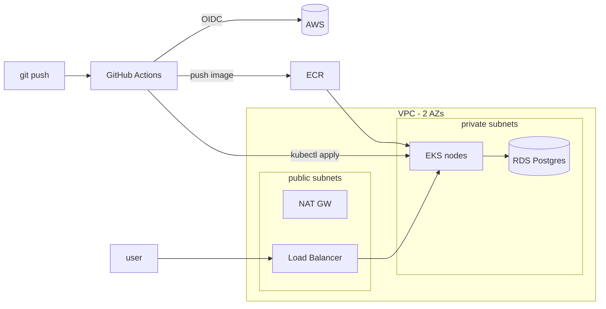

# Titan

Flask API running on EKS, with all of the AWS infrastructure written in Terraform. Pushing to `main` builds the image, pushes it to ECR and deploys it to the cluster through GitHub Actions.

## Architecture



- VPC with public and private subnets in two AZs, a NAT gateway and flow logs to CloudWatch
- EKS cluster and managed node group in the private subnets
- RDS PostgreSQL (Multi-AZ). The master password is managed by RDS in Secrets Manager and the DB only accepts traffic from the cluster security group
- ECR repo with scan on push
- GitHub Actions authenticates with an IAM role over OIDC, so there are no AWS keys in the repo settings
- Terraform state in S3 (versioned, encrypted) with a DynamoDB lock table

## Files

```
vpc.tf, flow_logs.tf        network
eks.tf, iam.tf, kubernetes.tf   cluster, node group, IAM roles, aws-auth
rds.tf                      database + security group
ecr.tf                      image registry
main.tf, backend.tf         provider, state bucket, lock table
app/                        Flask app
k8s/                        Deployment and LoadBalancer Service
.github/workflows/main.yml  build, push, deploy
```

## Running it

```bash
terraform init
terraform apply

aws eks update-kubeconfig --region eu-central-1 --name titan-eks-cluster
kubectl get pods,svc

# DB password
aws secretsmanager get-secret-value \
  --secret-id "$(terraform output -raw db_master_user_secret_arn)" \
  --query SecretString --output text

terraform destroy
```

## TODO

- One NAT gateway per AZ (kept to one for cost)
- Upgrade EKS from 1.29
- Give the CI role a namespaced Role instead of `system:masters`
- Move the state bucket and lock table into their own bootstrap config
