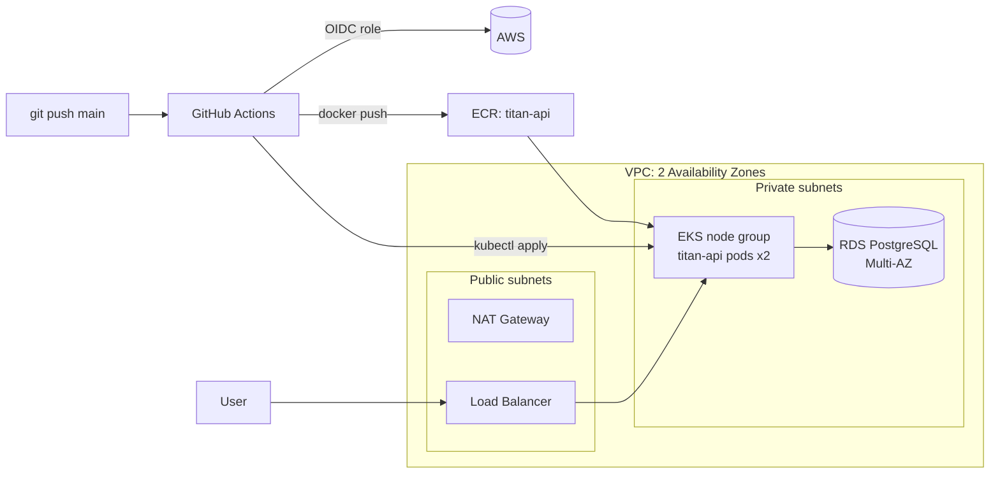

# Titan: Highly Available Flask API on AWS EKS

A production-style AWS platform built entirely with **Terraform**: a multi-AZ VPC, an **EKS** cluster, a **PostgreSQL RDS** database and an **ECR** registry. A **GitHub Actions** pipeline builds the app image, pushes it to ECR and rolls it out to EKS on every push to `main`, authenticating to AWS with **OIDC** (no long-lived keys).

## 🏛️ Architecture



## ✨ Highlights

- **High availability:** subnets, EKS nodes and RDS (Multi-AZ) are spread across two Availability Zones.
- **Private by default:** the database and worker nodes live in private subnets; only the load balancer is public.
- **Keyless CI/CD:** GitHub Actions assumes an IAM role through OIDC, so no AWS access keys are stored in GitHub.
- **No secrets in code:** the RDS master password is generated by AWS and kept in **Secrets Manager** (`manage_master_user_password`).
- **Remote state:** Terraform state lives in an encrypted, versioned S3 bucket with public access blocked.

## 🛠️ Tech stack

| Area | Tools |
|---|---|
| Cloud | AWS (VPC, NAT Gateway, EKS, ECR, RDS, IAM, S3, Secrets Manager) |
| Infrastructure as Code | Terraform |
| Containers | Docker, Kubernetes (EKS) |
| CI/CD | GitHub Actions with OIDC |
| Application | Python (Flask) |

## 📁 Repository layout

| Path | Contents |
|---|---|
| `vpc.tf` | VPC, public/private subnets in 2 AZs, NAT, routing |
| `eks.tf`, `iam.tf`, `kubernetes.tf` | EKS cluster, node group, IAM roles (incl. GitHub OIDC role) |
| `rds.tf` | Multi-AZ PostgreSQL in private subnets |
| `ecr.tf` | Container registry for the API image |
| `main.tf`, `backend.tf` | Provider and S3 remote state |
| `app/` | Flask API (`/` returns a JSON greeting) |
| `k8s/` | Deployment (2 replicas) and Service manifests |
| `.github/workflows/main.yml` | Build → push to ECR → deploy to EKS |

## 🚀 Usage

Prerequisites: an AWS account, AWS CLI, Terraform and kubectl.

```bash
terraform init
terraform apply          # provision VPC, EKS, RDS, ECR

aws eks update-kubeconfig --region eu-central-1 --name titan-eks-cluster
kubectl get pods         # titan-api pods after the first pipeline run

terraform destroy        # tear everything down to avoid costs
```

Read the generated database password from Secrets Manager:

```bash
aws secretsmanager get-secret-value \
  --secret-id "$(terraform output -raw db_master_user_secret_arn)" \
  --query SecretString --output text
```
