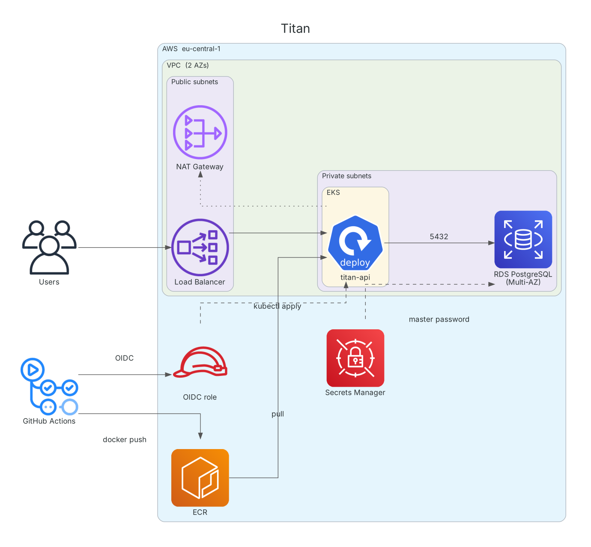

# Titan

[](https://github.com/denizomerf/titan-project/actions/workflows/ci.yml)

A Flask API on Amazon EKS with the full AWS environment defined in Terraform: a two-AZ VPC, a private EKS node group, Multi-AZ PostgreSQL and an ECR registry. GitHub Actions builds the image and deploys it to the cluster through an IAM role assumed with OIDC, so no long-lived AWS credentials are stored in GitHub.



## Infrastructure

| Component | Details |
|---|---|
| Network | VPC `10.0.0.0/16`, public and private subnets in `eu-central-1a/1b`, NAT gateway, VPC Flow Logs to CloudWatch |
| Compute | EKS 1.29, managed node group (`t3.small`, 1–3 nodes) in private subnets |
| Database | RDS PostgreSQL 17, Multi-AZ, private. Master password managed by RDS in Secrets Manager; access limited to the EKS cluster security group |
| Registry | ECR with image scanning on push |
| Access | GitHub OIDC role scoped to `main`, mapped into the cluster via `aws-auth` |
| State | S3 backend (versioned, encrypted, public access blocked) with DynamoDB locking |

## Application

- Flask API served by gunicorn, running as a non-root user
- `/` returns a greeting, `/healthz` is used by the readiness and liveness probes
- Kubernetes Deployment with 2 replicas, resource requests/limits, exposed through a `LoadBalancer` Service

## CI/CD

| Workflow | Trigger | Steps |
|---|---|---|
| [`ci.yml`](.github/workflows/ci.yml) | push, pull request | `terraform fmt` + `validate`, Docker build and smoke test, manifest validation with kubeconform |
| [`deploy.yml`](.github/workflows/deploy.yml) | manual | Assume the OIDC role, push the image to ECR, apply the manifests, wait for the rollout |

## Repository structure

```
.
├── app/                    Flask application
├── k8s/                    Deployment and Service manifests
├── vpc.tf, flow_logs.tf    Networking
├── eks.tf, iam.tf          EKS cluster, node group, IAM roles
├── kubernetes.tf           aws-auth mapping
├── rds.tf                  PostgreSQL and its security group
├── ecr.tf                  Container registry
├── main.tf, backend.tf     Provider, state bucket, lock table
└── .github/workflows/      CI and deploy pipelines
```

## Getting started

Prerequisites: AWS account, AWS CLI, Terraform >= 1.5, kubectl.

```bash
terraform init
terraform apply

aws eks update-kubeconfig --region eu-central-1 --name titan-eks-cluster
kubectl get nodes
```

Deploy the application by running the **Deploy** workflow from the Actions tab, then:

```bash
kubectl get svc titan-api-service     # external hostname of the load balancer
```

Retrieve the database password:

```bash
aws secretsmanager get-secret-value \
  --secret-id "$(terraform output -raw db_master_user_secret_arn)" \
  --query SecretString --output text
```

Tear down:

```bash
terraform destroy
```

## Roadmap

- One NAT gateway per AZ (a single gateway is used to reduce cost)
- Upgrade EKS to a currently supported version
- Replace the `system:masters` mapping for CI with a namespaced Role or EKS access entries
- Move the state bucket and lock table into a separate bootstrap configuration
